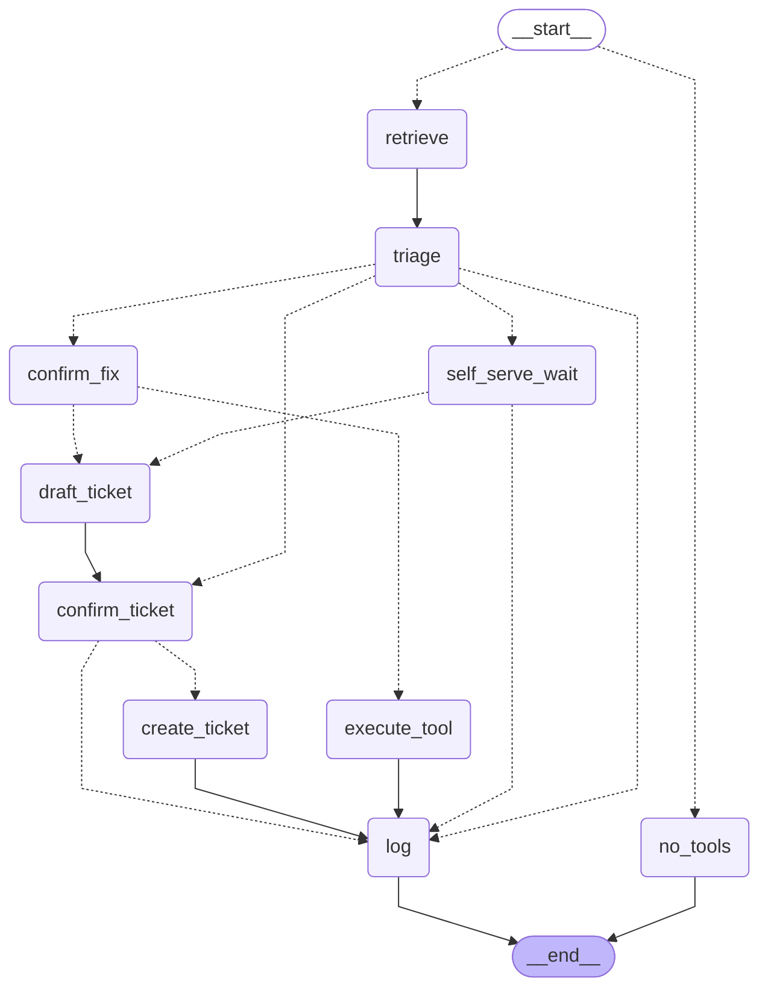

# FirstLine — L1 IT Support Agent

FirstLine does the first pass on L1 IT support tickets for a Swiss IT service provider: it looks up the client's knowledge base, picks one path, and proposes the next step for a technician to confirm.

### Problem

Most L1 tickets aren't hard — they're just troubleshooting simple, repetitive tasks. For an office worker, though, it doesn't feel small — work stops until someone shows up to fix it.

- **The work is repetitive, not complex.** Routine issues (software installs, OS config, workplace setup) sit in a queue until a technician is free, identifies the pattern, looks up the procedure, and acts. The fix is rarely novel — the dispatch delay is the struggle.
- **In Swiss SMEs, dispatch means travel.** A single technician often supports multiple client locations, since a small office can't justify a full-time on-site IT presence. Travel time to and from site is frequently a larger cost than the fix itself.
- **Skilled IT hours are expensive and scarce in this region.** Time spent traveling and pattern-matching a known issue is time not spent on the complex work only that technician can do.

**FirstLine targets exactly that slice: high-frequency, well-documented, low-novelty tickets — resolved remotely, before a trip is even needed.**

### Stakeholder Profiles Breakdown

| Stakeholder | Job-to-be-Done | Pain | Gain — Basic | Gain — Surprising | Key metric |
|---|---|---|---|---|---|
| **Employees** | Get back to work with minimal disruption | Long wait for trivial issues; repeating context to technicians | Faster resolution for well-documented issues | Explainable, grounded self-serve guides for basic IT issues; generating a service ticket based on their issue automatically | Mostly qualitative, but IT issues influence productivity|
| **L1 Technicians** (on-site dispatch, multi-client) | Triage & resolve routine tickets, escalate the rest with context | Repetitive pattern-matching across multiple unfamiliar client environments; unclear user requests | Fewer routine tickets to resolve manually or dispatch for | AUTO_FIX shifts burden from diagnosis to confirmation; escalation write-ups auto-generated | Time-to-first-action|
| **L2/L3 Specialists** (remote, outsourced offshore)| Resolve complex issues without re-diagnosing from scratch; keep documentation up-to-date | Escalations under-documented; no live L1 to call back and clarify across timezones; quality varies by which L1 technician handled it | Escalations arrive with diagnostic summary + retrieval trace | Consistent documentation regardless of which technician escalated | Mean-time-to-resolution |
| **CTO** (of the IT service provider) | Keep cost-per-ticket low, maintain SLA & audit compliance; price and justify contracts | Cost-per-ticket opaque; no per-category automation visibility; audit risk on unlogged fixes | Lower cost-per-ticket; automation-rate reporting by client account | Automation-rate data becomes a pricing/contract lever — accounts with low automation potential (highly custom environments) can be identified and priced or staffed differently  | Cost-per-ticket by category; SLA compliance rate |

### Economic potential:

**Assumption:** ~4 tickets/day/technician, ~2 h avg per ticket including travel to and from client site.

| Automation rate | Time recovered/day | Value/technician/year |
|---|---|---|
| 30% (conservative) | ~2.4 h | ~CHF 32k |
| 50% (target) | ~4.0 h | ~CHF 53k |
| 70% (optimistic) | ~5.6 h | ~CHF 74k |

*(CHF 60/h fully-loaded technician cost, 220 working days/year, 2h/ticket including travel, 4 tickets/day.)*

For SME customers specifically, remote resolution via SELF_SERVE/AUTO_FIX removes the travel leg entirely for automatable tickets — this is not just faster resolution, it's a dispatch trip that never has to happen. Not netted against this figure: knowledge-base curation/maintenance effort, LLM inference cost per ticket, and technician review overhead during AUTO_FIX confirmation.

### Data potential
Every completed triage run (one that reaches a final state; RAG-off runs, which have no decision path, are not logged) appends a row to `logs.csv` — query, retrieved units, decision path, diagnostic summary, tool called, operator confirmation, escalation queue/priority, response time — and the dashboard's "Live usage statistics" panel turns that into a running summary (path distribution, automation rate, avg response time). Over time, the same log supports:
- Retrieval threshold tuning, per category
- Cost-per-resolution-path analysis (AUTO_FIX cost vs. ESCALATE technician-hour cost)
- A natural link to quantitative/pricing-style analysis of automation vs. human dispatch

---

## Architecture



*Generated from the compiled graph (`build_graph(...).get_graph().draw_mermaid()`), so it cannot drift from the code. Dotted edges are conditional routers (`graph.py`: `route_start`, `route_after_triage`, `route_after_confirm_fix`, `route_after_confirm_ticket`, `route_after_self_serve`); `confirm_fix`, `confirm_ticket` and `self_serve_wait` are the human gates.*

| Path | When | Operator action required? |
|---|---|---|
| **SELF_SERVE** | Fix is documented, safe, and user-executable | No — steps returned directly; "didn't resolve it" button escalates |
| **AUTO_FIX** | Fix is documented, reversible, better run by the agent | Yes — Confirm runs the tool; Cancel pre-fills an escalation ticket instead of just dropping the issue |
| **ESCALATE** | Info missing, infra-/hardware-/IAM-side issue, or low confidence | Yes — Confirm or Cancel before ticket is created |
| **OUT_OF_SCOPE** | Not a workplace-technology request at all | No — declined immediately |

---

## How to run

```bash
uv sync
npm install
cp .env.example .env    # then add your ANTHROPIC_API_KEY
npm run dev             # http://localhost:5173
```

Checks, with no API key needed: `uv run poe check`.

## Documentation

- [What it must do](docs/SPEC.md)
- [The current sprint and where it's heading](docs/ROADMAP.md)
- [The tech choices](docs/TECH_STACK.md)
- [How the dashboard looks](docs/BRAND.md)
- [How to write the code](docs/CODE_STANDARDS.md)
- [How to run, plan and check the work](docs/PROCESS.md)
- [What's built, and which rules code enforces](docs/STATUS.md)
- [Design decisions and known limitations](docs/DECISIONS.md)

## Results

The baseline: one model call per ticket with `claude-haiku-4-5`, version `93b8e4f5`, run on 7 November 2026 and re-scored for free on 8 November after the owner reviewed two causes. The ± is the 95% margin of error. Mistake costs are assumptions, and they count every mistake as if nobody caught it at review.

| Set | Tickets | Path | Action | Right team | Kappa | Mistakes (CHF) |
|---|---|---|---|---|---|---|
| Rules set | 25 | 80% ±15% | 72% ±17% | 75% ±26% | 0.71 | 600 |
| Development | 129 | 73% ±8% | 71% ±8% | 70% ±9% | 0.44 | 9,960 |
| Unseen families | 52 | 60% ±13% | 31% ±12% | 31% ±12% | 0.00 | 3,420 |

Beside the two yardsticks:

| Set | Measure | FirstLine | Simple classifier | Most common answer |
|---|---|---|---|---|
| Rules set | Path | **80%** | 56% | 40% |
| Development | Path | 73% | **93%** | 70% |
| Development | Action | 71% | **91%** | 16% |
| Development | Mistakes (CHF) | 9,960 | **1,140** | 8,880 |
| Unseen families | Path | 60% | **100%** | **100%** |
| Unseen families | Right team | **31%** | 0% | 0% |

What it says:

- **The agent doesn't beat both yardsticks yet.** It wins on short, real requests (the rules set) and is the only one that finds the right team for families with no playbook. On the templated development tickets, a free classifier does better on everything.
- **Most tickets should be escalated**, 63% of the development set, so always escalating to `DESK-SUPPORT` gets the path right nearly as often as the agent. The agent earns its keep on the action and team, not the path.
- **Three security mistakes cost CHF 6,000 of the 9,960**, which makes the agent's mistakes dearer than always escalating. The agent proposed a routine fix on a possible compromise. SEC-04 moves into code in commit 6.
- **Disk encryption is the clearest weakness.** On 6 of 7 tickets where the TPM was never set up, the agent proposed escrowing the recovery key, which the playbook says only works on healthy encryption.
- **On unseen families it says "out of scope" too often** (21 of 52), when those are IT problems for another team.
- **It's cheap:** about CHF 0.005 and 5 seconds a ticket. All 206 practice tickets cost CHF 0.98, and re-scoring after a label change costs nothing.

Nothing was tuned on the held-out sets, which run once at sprint review.
